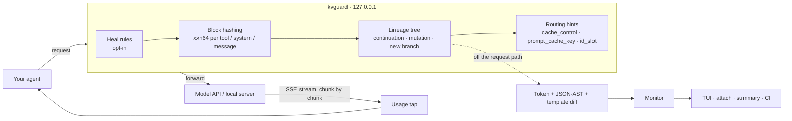

<div align="center">

# kvguard

### Your prompt cache is silently breaking. kvguard shows you where, why, and what it costs.

[](https://github.com/tranhoangtu-it/kvguard/actions/workflows/ci.yml)
[](https://github.com/tranhoangtu-it/kvguard/releases)
[](https://www.npmjs.com/package/kvguard)
[](https://pypi.org/project/kvguard/)
[](#license)

**Anthropic · OpenAI · llama.cpp · Ollama · any OpenAI-compatible server**<br>
One ~6 MB binary. No Docker, no database, no account, no telemetry.

```bash
npx kvguard -- claude
```

</div>

---

## The problem nobody sees

Prompt caches (Anthropic, OpenAI) and local KV caches (llama.cpp, Ollama, vLLM) only reuse work when your new prompt starts with **exactly** the same bytes as the previous one, in order `tools → system → messages`.

Change **one token** near the top and everything after it is billed — or prefilled on your GPU — again:

- MCP servers finish starting in a different order, so `tools[]` is serialized differently each session.
- A `Current time: 2026-11-04T19:42:07Z` line changes every turn.
- A compaction step rewrites one old message.
- Claude Code's rotating `x-anthropic-billing-header: cch=…` lands at the top of the system prompt when you point it at a local server.
- A Qwen chat template silently drops `<think>` from an earlier turn.

And sometimes it isn't your client at all: the prefix is intact, but the provider serves only part of it from cache.

**Nothing errors.** Responses look identical. The only symptom is your bill and your wait time.

> **Illustrative math (Claude Sonnet 4.5, $3/M input):** re-writing an 80K-token context instead of reading it from cache costs about **$0.28** per broken turn (5-minute TTL) or **$0.46** with the 1-hour TTL. *If* 40 turns a day break, that is $11–18 per developer per day. On a local GPU at ~850 tok/s the same miss costs ~94 seconds of prefill. Run kvguard in observe mode for a day to get your own number.

## Claude Code in three steps

1. **Observe** — nothing is rewritten, requests pass through byte-for-byte:
   ```bash
   npx kvguard -- claude
   ```
2. **Read the verdict.** When Claude Code exits you get a one-paragraph summary; for the live view run `npx kvguard attach` in a second terminal.
3. **Heal only if it helps.** If the summary shows busts with a fixable cause, restart with `npx kvguard --heal -- claude`.

Your API key or Claude login is forwarded to Anthropic and never logged, recorded or written to disk (see [Security](#security)).

## What kvguard does

kvguard is a local proxy with a terminal UI. It sits between your agent and the model and, **for every request**:

| | |
|---|---|
| 🧭 **Tracks the conversation** | Matches each request to the branch it continues, so sub-agents, title generators and parallel sessions don't show up as false alarms. |
| 🔬 **Diffs the prefix** | When it breaks, reports the exact **JSON path**, the **token index** and a **root cause**. |
| 💸 **Measures the damage** | Reads real cache usage from the response stream (`cache_read_input_tokens`, `cached_tokens`, llama.cpp `cache_n`) and prices what was lost from those provider numbers. |
| ⚖️ **Says whose fault it is** | A broken prefix is your client's; an intact prefix that the provider served only partly is the provider's. They are reported separately. |
| 🩹 **Heals it (opt-in)** | `--heal` reorders tools and schema keys, adds cache hints and routes llama.cpp slots — without changing what the model reads. |
| 🚦 **Gates CI** | Replays recorded traffic and fails the build when a change breaks the cache. |

Example of the live view (`kvguard attach`; numbers are illustrative):

```
┌ kvguard v0.3.0 · http://127.0.0.1:4141 ──────────────────────────────────────────────────────────────────┐
│ 🔍 INSPECT ONLY  │  CACHE HIT 97.4%  │  TOKENS SAVED 1.42M tok  │  $4.82 saved | $0.14 wasted  │  GPU …    │
└──────────────────────────────────────────────────────────────────────────────────────────────────────────┘
 Turn  Branch / Slot    Model               Prefix Health  Hit %  Root Cause / Action
 #03   main             claude-sonnet-4-5   [██████████]    98%   ✅ HIT
 #04   main             claude-sonnet-4-5   [█░░░░░░░░░]    12%   ❌ BUST @ tok ~#418 (timestamp in prefix · system[1].text)
 #05   main             claude-sonnet-4-5   [████░░░░░░]    41%   ◐ PARTIAL: provider read 25,165 of 61,040 expected (41%) — provider-side
 #06   sub-1            claude-haiku-4-5    [··········]     –    ◆ NEW BRANCH
┌ X-Ray Diff Inspector [JSON AST] ─────────────────────────────────────────────────────────────────────────┐
│ Divergence at Token ~#418 / 41,950 (o200k est.) │ JSON Path: system[1].text │ Impact: -$0.142           │
│ - Turn N-1: Current time: 2026-11-04T19:42:07Z                                                           │
│ + Turn N:   Current time: 2026-11-04T19:43:12Z                                                           │
└──────────────────────────────────────────────────────────────────────────────────────────────────────────┘
 [h] Toggle Auto-Heal  [d] View: JSON AST / Tokens  [f] Filter: Busts Only  [e] Export Trace  [q] Quit
```

Local models work the same way:

```bash
npx kvguard --target http://127.0.0.1:8080 -- opencode    # llama-server
npx kvguard --target http://127.0.0.1:11434 -- my-agent   # Ollama
```

## Install

| Method | Command |
|---|---|
| Homebrew (macOS, Linux) | `brew install tranhoangtu-it/tap/kvguard` |
| npm | `npx kvguard …` or `npm i -g kvguard` |
| Python | `uvx kvguard …` or `pipx run kvguard …` |
| Binary | [GitHub Releases](https://github.com/tranhoangtu-it/kvguard/releases) — Linux x86_64/arm64 (static musl), macOS Intel/Apple Silicon, Windows x86_64; SHA-256 checksums and build-provenance attestations |
| Source | `cargo install --git https://github.com/tranhoangtu-it/kvguard --locked` |

The npm and Python launchers download the release binary for your platform on first run and verify its checksum before executing it.

## What it catches

| Root cause | Typical source | With `--heal` |
|---|---|---|
| `tools[] order shuffled` | MCP servers starting asynchronously | ✅ sorted by name |
| `tool schema key order changed` | non-deterministic JSON Schema serialization | ✅ RFC 8785 key order |
| `volatile header/id in system` | Claude Code `cch=` header on non-Anthropic backends, request ids | ✅ header removed (local & third-party backends only) |
| `timestamp in prefix` | `Current time: …` with seconds | ⚙️ `--pin-timestamps` (the model then sees the session start time) |
| `chat template drift` | Qwen/DeepSeek templates dropping `<think>` from old turns | ⚙️ `--normalize-think-tags`; detected automatically on llama-server |
| `history message mutated` | compaction, placeholders, truncated tool output | 🔎 reported with the exact JSON path |
| `system prompt changed` · `tool set changed` | real edits | 🔎 reported |
| **PARTIAL** with an intact prefix | provider-side cache collapse; >20 content blocks since the last cache point (Anthropic lookback); >15 req/min on one OpenAI cache key | 🔎 expected vs. served tokens and the likely reason |
| **MISS** with an intact prefix | cache TTL expiry, eviction | 🔎 reported, not blamed on your client |
| sub-agent evicting the main KV slot | llama-server with parallel slots | ✅ main pinned to `id_slot 0`, sub-agents rotate |
| sub-agent sharing a one-slot llama-server | llama-server started without `-np` | 🔎 advises `-np 2 --kv-unified` |

✅ part of `--heal` · ⚙️ separate opt-in flag · 🔎 diagnosis only

## Expected vs. actual: the cache audit

For every continuing turn kvguard knows what *should* come from cache — the prefix the previous turn read or wrote, as reported by the provider itself, so tokenizer differences don't matter — and compares it with what the provider actually served:

| Verdict | Meaning |
|---|---|
| ✅ `HIT` | The provider served what the previous turn cached. |
| ❌ `BUST` | Your request changed an earlier part of the prompt. Fix the client, or try `--heal`. |
| ◐ `PARTIAL` | Prefix intact, but the provider served less than `--partial-threshold` (default 80 %) of the expected cache. Not your client's fault. |
| ⚠ `MISS` | Prefix intact, nothing served from cache — usually TTL expiry. |

Wasted dollars are computed from the provider's own numbers (`expected − served`) at the correct write price — 1.25× input for Anthropic's 5-minute TTL, 2× for the 1-hour TTL. Prompts below a model's minimum cacheable size never raise an alert. Prices are built-in list prices; override them with `--prices prices.json`.

## CI gate

The defensible use of kvguard: catch cache regressions in code review, before they reach anyone's bill.

```bash
kvguard --record trace.jsonl -- my-agent run-scenario   # record once, commit the trace
kvguard check trace.jsonl --fail-on-bust --min-hit-rate 0.95
```

Or with the GitHub Action:

```yaml
- uses: tranhoangtu-it/kvguard@v0.3.0
  with:
    files: tests/traces/*.jsonl
    min-hit-rate: "0.95"
```

The report lands in the job summary and ends with an explicit verdict:

```
| 3 | turn-3.json | main | ❌ BUST @ tok ~#44 | 44 / 105 | history message mutated at `messages[1].content` |

**Result: FAIL** — 1 bust(s) with --fail-on-bust (exit 1)
```

## Heal rules

`--heal` contains only rewrites that **keep what the model reads**:

- **Tool canonicalization** — tools sorted by name, schema keys in RFC 8785 order. `enum` order and data arrays are never touched.
- **Billing header** — Claude Code's `x-anthropic-billing-header` line is removed only for local and third-party backends; the official Anthropic API keeps it.
- **Cache hints** — `cache_control` breakpoints only when the client sent none, only on blocks Anthropic accepts, never more than four; `prompt_cache_key` only for `api.openai.com`.
- **Slot routing** — `id_slot` / `cache_prompt` only for a detected llama-server with two or more slots, and never over a slot the client chose.

Rewrites that **change what the model reads** are separate flags you opt into one by one:

| Flag | Effect |
|---|---|
| `--pin-timestamps` | ISO-8601 times in the system prompt are pinned per session — the model keeps seeing the session start time. |
| `--relocate-git-status` | Claude Code's `gitStatus:` section moves to the newest turn and is replayed byte-identically on later turns. |
| `--normalize-think-tags` | `<think>` / `<thinking>` / `[THINK]` blocks are removed from assistant turns *before* the latest user message (local backends only); the current tool loop keeps its reasoning. |

Toggling heal mid-session rebuilds the prefix once — expected, and shown in the TUI.

## Metrics & status line

```bash
kvguard status --line                                         # kvguard 🔍 97% hit · $4.82 saved · 1 bust
curl -s -H "x-kvguard-token: $KVGUARD_TOKEN" http://127.0.0.1:4141/__kvguard/metrics
```

Start the proxy with `--control-token` (or `KVGUARD_TOKEN`) to scrape it with Prometheus (`authorization: { credentials: … }`). Metrics include turns, busts, partials, misses, prompt and cached tokens, USD saved/wasted, GPU seconds and `kvguard_recent_turns{model,status}`. `status --line` prints `kvguard off` (exit 0) when no proxy is running, so it is safe in a shell prompt, tmux or Claude Code's `statusLine`.

## How it works



- **Inline work is parsing, hashing and comparison.** Measured overhead for an 80K-token request: **+1.0 ms** at the median in observe mode, **+1.4 ms** with `--heal` ([benchmarks](docs/benchmarks.md)). Responses stream through untouched.
- **Lineage, not "previous request".** Each request is matched to the branch whose last turn is its prefix, or — if the prefix broke — to the branch that shares its history. Unrelated requests start a new branch instead of raising an alarm.
- **Provider truth beats estimates.** Hit rates and dollar figures come from the usage fields the provider returns; token estimates fill the gaps and are labeled as such.

## Accuracy, honestly

- **JSON paths, byte offsets and provider usage are exact.** Against **llama-server**, token indexes are exact too — kvguard renders both turns with the server's own `/apply-template` and `/tokenize`, which also reveals chat-template drift. Elsewhere token indexes are `o200k_base` estimates: exact for GPT-4o/GPT-5-family, approximate for Claude, whose tokenizer is not public.
- **"Whose fault" is a classification.** Lineage matching is a heuristic (same opening message and system prompt, or ≥ 70 % shared history); a misattributed branch means a misattributed verdict.
- **Clients must honor base-URL variables.** Cursor sends requests through its own backend, so no local proxy can see them.
- **Ollama's native API doesn't report reused tokens**; its OpenAI-compatible `/v1` endpoint does.
- **Validated on real traffic, but not at scale yet:** Claude Code → Anthropic API (turn 2 read exactly the 95,836 tokens turn 1 wrote → `HIT`) and Ollama 0.35. What hasn't been measured is listed in [docs/benchmarks.md](docs/benchmarks.md#not-measured-yet).

## Security

- Listens on `127.0.0.1` only; forwards only to the upstream you configured; never follows redirects; no telemetry.
- API keys and OAuth tokens in request headers are forwarded and **never** logged, recorded or exported.
- `/__kvguard/*` requires a random per-process control token, a loopback `Host` and no browser `Origin` — other local users, DNS rebinding and CSRF can't read your prompts or flip heal.
- Traces, exports and the attach file are owner-only (`0600`) on Unix. They contain prompts: treat them like source code.
- Release binaries are attested by GitHub Actions (`gh attestation verify`). Details and reporting: [SECURITY.md](SECURITY.md).

## Options

| Flag | Meaning |
|---|---|
| `--heal` | Safe heal rules (toggle live with `h`) |
| `--pin-timestamps` · `--relocate-git-status` · `--normalize-think-tags` | Opt-in rewrites that change what the model reads |
| `--target URL` | Send every API family to one upstream |
| `--backend auto\|llama-cpp\|ollama\|generic` | Upstream type; `auto` probes llama-server and Ollama |
| `--slots N` | Override the llama-server slot count |
| `--chat-template FILE` | `.jinja` or `tokenizer_config.json` for template-drift detection on non-llama servers |
| `--partial-threshold F` | Report `PARTIAL` below this share of the expected cache read (default 0.8) |
| `--prices FILE` | Override list prices (`{"model": {"input": …, "cache_write": …, "cache_read": …}}`, USD per M tokens) |
| `--control-token T` | Fixed control-endpoint token (also `KVGUARD_TOKEN`); random by default |
| `--record FILE` | Append forwarded requests to JSONL (input for `check`) |
| `--no-tui` | One line per request instead of the full-screen TUI |
| `--port N` · `--prefill-tps N` | Listen port (default 4141) · reference prefill speed (default 850) |

## Compared to

| | Approach | kvguard |
|---|---|---|
| caching.ai | Docker + Postgres + web console | one binary, local backends, token-level diff |
| CacheLint | static analysis | runtime: sees the prefixes your agent actually sends |
| cachebench | SDK-side observability library | drop-in proxy: no code changes, any client, plus healing |
| LiteLLM · Portkey · Helicone | central gateways that log cache usage | prefix diffing, lineage and exact local tokenization; runs on a laptop |
| claude-code-cache-fix · ccstatusline | Claude Code–specific | Anthropic, OpenAI, llama.cpp, Ollama |

## Roadmap

Next: a central gateway mode with OpenTelemetry export and a container image, llama-swap support, warnings before `n_ctx` overflow, llama-server slot save/restore, and published false-positive rates on real session traces. See [the analysis and roadmap](docs/kvguard-problem-analysis-and-roadmap.md) and [CHANGELOG](CHANGELOG.md).

## Development

```bash
cargo test                                         # unit + end-to-end tests against a wiremock upstream
cargo clippy --all-targets -- -D warnings
cargo run --release --example proxy_overhead       # latency benchmark
```

CI runs formatting, clippy, tests on Linux/macOS/Windows, an MSRV (1.88) check and a smoke test of the GitHub Action on every pull request. Tagging `v*` builds and attests binaries for five targets; with a trusted publisher configured on npm / PyPI and the repository variables `PUBLISH_NPM` / `PUBLISH_PYPI` set to `true`, the same tag also publishes the launchers — no tokens involved.

## License

Dual-licensed under [MIT](LICENSE-MIT) or [Apache-2.0](LICENSE-APACHE), at your option.
