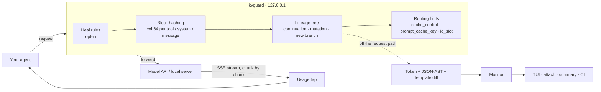

<div align="center">

# kvguard

### Your prompt cache is silently breaking. kvguard shows you where, why, and what it costs — then fixes it.

[](https://github.com/tranhoangtu-it/kvguard/actions/workflows/ci.yml)
[](https://github.com/tranhoangtu-it/kvguard/releases)
[](https://www.npmjs.com/package/kvguard)
[](https://pypi.org/project/kvguard/)
[](#license)

**Anthropic · OpenAI · llama.cpp · Ollama · any OpenAI-compatible server**<br>
One ~6 MB download. No Docker. No database. No account. Nothing leaves your machine.

```bash
npx kvguard --heal -- claude
```

</div>

---

## The problem nobody sees

Prompt caches (Anthropic, OpenAI) and local KV caches (llama.cpp, Ollama, vLLM) only reuse work when your new prompt starts with **exactly** the same bytes as the previous one, in order `tools → system → messages`.

Change **one token** near the top and everything after it is billed — or prefilled on your GPU — again:

- Claude Code inserts a rotating `x-anthropic-billing-header: cch=…` at the top of the system prompt.
- MCP servers finish starting in a different order, so `tools[]` is serialized differently each session.
- A `Current time: 2026-11-04T19:42:07Z` line changes every turn.
- A compaction step rewrites one old message.
- A Qwen chat template silently drops `<think>` from an earlier turn.

**Nothing errors.** Responses look identical. The only symptom is your bill and your wait time.

> **Example math (Claude Sonnet 4.5, $3/M input):** re-writing an 80K-token context instead of reading it from cache costs about **$0.28** per broken turn (5-minute TTL) or **$0.46** with the 1-hour TTL. At 40 broken turns a day that is **$11–18/day for one developer**. On a local GPU at ~850 tok/s, the same miss costs **~94 seconds** of prefill.

## What kvguard does

kvguard is a local proxy with a terminal UI. It sits between your agent and the model and, **for every request**:

| | |
|---|---|
| 🧭 **Tracks the conversation** | Matches each request to the branch it continues, so sub-agents, title generators and parallel sessions never show up as false alarms. |
| 🔬 **Diffs the prefix** | When it breaks, reports the exact **JSON path**, the **token index**, and a **root cause** — not "cache miss". |
| 💸 **Measures the damage** | Reads real cache usage from the response stream (`cache_read_input_tokens`, `cached_tokens`, llama.cpp `cache_n`) without delaying a single byte, and prices what was lost from those provider numbers. |
| ⚖️ **Tells you whose fault it is** | A broken prefix is *your* client's fault. An intact prefix that the provider still served only partly from cache is *theirs* — kvguard reports the two separately. |
| 🩹 **Heals it (opt-in)** | Rewrites requests so the prefix stays byte-stable: sorts tools, canonicalizes schemas, strips volatile headers, pins timestamps, routes llama.cpp slots. |
| 🚦 **Gates CI** | Replays recorded traffic and fails the build when a code change breaks the cache. |

## 60-second start

```bash
# Wrap any agent. kvguard points it at itself, stays silent, and prints a summary on exit.
npx kvguard --heal -- claude

# In a second terminal: the live dashboard.
npx kvguard attach
```

```
┌ kvguard v0.2.0 · http://127.0.0.1:4141 ──────────────────────────────────────────────────────────────────┐
│ 🔥 AUTO-HEAL: ON  │  CACHE HIT 97.4%  │  TOKENS SAVED 1.42M tok  │  $4.82 saved | $0.14 wasted  │  GPU … │
└──────────────────────────────────────────────────────────────────────────────────────────────────────────┘
 Turn  Branch / Slot    Model               Prefix Health  Hit %  Root Cause / Action
 #03   main             claude-sonnet-4-5   [██████████]    98%   ✅ HIT
 #04   main             claude-sonnet-4-5   [█░░░░░░░░░]    12%   ❌ BUST @ tok ~#418 (timestamp in prefix · system[1].text)
 #05   main             claude-sonnet-4-5   [██████████]    96%   ⚡ HEALED (sorted 48 tools + pinned 1 timestamp(s))
 #06   sub-1            claude-haiku-4-5    [··········]     –    ◆ NEW BRANCH
┌ X-Ray Diff Inspector [JSON AST] ─────────────────────────────────────────────────────────────────────────┐
│ Divergence at Token ~#418 / 41,950 (o200k est.) │ JSON Path: system[1].text │ Impact: -$0.142           │
│ - Turn N-1: Current time: 2026-11-04T19:42:07Z                                                           │
│ + Turn N:   Current time: 2026-11-04T19:43:12Z                                                           │
└──────────────────────────────────────────────────────────────────────────────────────────────────────────┘
 [h] Toggle Auto-Heal  [d] View: JSON AST / Tokens  [f] Filter: Busts Only  [e] Export Trace  [q] Quit
```

Local models work the same way:

```bash
npx kvguard --heal --target http://127.0.0.1:8080 -- opencode   # llama-server
npx kvguard --heal --target http://127.0.0.1:11434 -- my-agent  # Ollama
```

## Install

| Method | Command |
|---|---|
| npm | `npx kvguard …` or `npm i -g kvguard` |
| Python | `uvx kvguard …` or `pipx run kvguard …` |
| Binary | [GitHub Releases](https://github.com/tranhoangtu-it/kvguard/releases) — Linux x86_64/arm64 (static musl), macOS Intel/Apple Silicon, Windows x86_64, each with a SHA-256 checksum |
| Source | `cargo install --git https://github.com/tranhoangtu-it/kvguard --locked` |

The npm and Python launchers download the release binary for your platform on first run and verify its checksum before executing it.

## What it catches

| Root cause | Typical source | `--heal` |
|---|---|---|
| `tools[] order shuffled` | MCP servers starting asynchronously | ✅ sorted by name |
| `tool schema key order changed` | non-deterministic JSON Schema serialization | ✅ RFC 8785 key order |
| `volatile header/id in system` | Claude Code `cch=` header on non-Anthropic backends, request ids | ✅ stripped (local & third-party backends only) |
| `timestamp in prefix` | `Current time: …` with seconds | ✅ pinned per session |
| `chat template drift` | Qwen/DeepSeek templates dropping `<think>` from old turns | ✅ `--normalize-think-tags` |
| `history message mutated` | compaction, placeholders, truncated tool output | 🔎 reported with the exact JSON path |
| `system prompt changed` · `tool set changed` | real edits | 🔎 reported |
| **MISS** with an intact prefix | cache TTL expiry, eviction | 🔎 reported, not blamed on your client |
| **PARTIAL** with an intact prefix | provider-side cache collapse; more than 20 content blocks since the last cache point (Anthropic's lookback window); >15 req/min on one OpenAI cache key | 🔎 reported with expected vs. actual cached tokens and the likely reason |
| sub-agent evicting the main KV slot | llama-server with parallel slots | ✅ main pinned to `id_slot 0`, sub-agents rotate |

## How it works



- **Inline work is hashing and comparison only.** Tokenization and diffing run in the background; response bodies stream through untouched, so time-to-first-token does not change.
- **Lineage, not "previous request".** Each request is matched to the branch whose last turn is its prefix, or — if the prefix broke — to the branch that shares its history. Unrelated requests start a new branch instead of raising an alarm.
- **Provider truth beats estimates.** Hit rate and dollar figures come from the usage fields the provider returns; token estimates fill the gaps and are labeled as such.

## CI gate

Catch cache regressions in code review, before they reach anyone's bill:

```bash
kvguard --record trace.jsonl -- my-agent run-scenario   # record once
kvguard check trace.jsonl --fail-on-bust --min-hit-rate 0.95
```

```yaml
# .github/workflows/cache.yml
- run: npx kvguard check tests/traces/*.jsonl --fail-on-bust --min-hit-rate 0.95 >> "$GITHUB_STEP_SUMMARY"
```

`check` accepts `.json` request bodies or `.jsonl` traces, expands globs itself, writes a Markdown report and exits `1` on failure:

```
| # | source      | branch | verdict            | reused / parent prefix | root cause                                        |
| 3 | turn-3.json | main   | ❌ BUST @ tok ~#44 | 44 / 105               | history message mutated at `messages[1].content` |
```

## Expected vs. actual: the cache audit

For every continuing turn kvguard knows what *should* come from cache — the prefix the previous turn read or wrote, as reported by the provider itself (so tokenizer differences don't matter) — and compares it with what the provider actually served:

| Verdict | Meaning |
|---|---|
| ✅ `HIT` | The provider served what the previous turn cached. |
| ❌ `BUST` | Your request changed an earlier part of the prompt. Fix the client (or `--heal`). |
| ◐ `PARTIAL` | Prefix intact, but the provider served less than `--partial-threshold` (default 80 %) of the expected cache — e.g. a Claude Code session where cache reads collapse from 640K to a fixed 25K tokens. Not your client's fault. |
| ⚠ `MISS` | Prefix intact, nothing served from cache — usually TTL expiry. |

Wasted dollars are computed from the provider's own numbers (`expected − served`) at the correct write price — 1.25× for Anthropic's 5-minute TTL, 2× when the request asks for the 1-hour TTL. Prompts below a model's minimum cacheable size never raise an alert.

## Metrics & status line

```bash
curl -s http://127.0.0.1:4141/__kvguard/metrics   # Prometheus: turns, busts, partials, misses, tokens, USD, GPU seconds
kvguard status --line                             # kvguard ⚡ 97% hit · $4.82 saved · 1 bust
```

`status --line` prints `kvguard off` (exit 0) when no proxy is running, so it is safe to embed in a shell prompt, tmux or Claude Code's `statusLine` command.

## Heal rules — and what they will never do

`--heal` rewrites requests **only in ways that keep their meaning**, and only where it is safe:

- **Tool canonicalization** — sort tools by name and schema keys by RFC 8785. `enum` order and data arrays are never touched.
- **Billing header** — stripped only for local and third-party backends. The official Anthropic API keeps it.
- **Timestamps** — ISO-8601 date-times in the system prompt are pinned per session (the model sees the session start time). Bare numbers that could be IDs are never rewritten.
- **`cache_control` breakpoints** — added only when the client sent none, only on blocks Anthropic accepts, never more than four.
- **`prompt_cache_key`** — added only for `api.openai.com`, never sent to gateways that may reject unknown fields.
- **Slot routing** — `id_slot` / `cache_prompt` only for a detected llama-server with two or more slots.
- **Opt-in rewrites** — `--relocate-git-status` moves Claude Code's `gitStatus:` section to the newest turn and replays it byte-identically on later turns; `--normalize-think-tags` strips historical `<think>` blocks on local backends.

Toggling heal mid-session rebuilds the prefix once — that is expected and shown in the TUI.

## Accuracy, honestly

- **JSON paths, byte offsets and provider usage are exact.** Token indexes are estimates using `o200k_base` — exact for GPT-4o/GPT-5-family, approximate for Claude (tokenizer not public) and local models.
- **Prices** are built-in list prices; unknown model versions fall back to their family.
- **Clients must honor base-URL variables.** Cursor sends requests through its own backend, so no local proxy can see them.
- **Ollama doesn't report reused tokens**, so its hit rate is estimated from the request diff.
- **Verified against real traffic:**
  - **Claude Code → Anthropic API:** turn 1 wrote 95,836 tokens to cache; turn 2 (`--continue`) read exactly 95,836 — kvguard's expectation matched to the token and the turn was classified `HIT`.
  - **Ollama 0.35** (`qwen2.5:7b-instruct`): the second turn was classified `HIT` and Ollama reported 1,619 of 1,635 prompt tokens cached.

## Security

The proxy listens on `127.0.0.1` only. Control endpoints (`/__kvguard/*`) reject non-loopback `Host` headers and any browser `Origin`, which blocks DNS-rebinding and CSRF. Redirects are never followed. Recorded traces and exported files contain full prompts — treat them like source code.

## Options

| Flag | Meaning |
|---|---|
| `--heal` | Enable heal rules (toggle live with `h`) |
| `--target URL` | Send every API family to one upstream |
| `--backend auto\|llama-cpp\|ollama\|generic` | Upstream type; `auto` probes llama-server `/props` and `/slots` |
| `--slots N` | Override the llama-server slot count |
| `--relocate-git-status` · `--normalize-think-tags` | Opt-in rewrites (see above) |
| `--chat-template FILE` | `.jinja` or `tokenizer_config.json` for template-drift detection |
| `--record FILE` | Append forwarded requests to JSONL (input for `check`) |
| `--partial-threshold F` | Report `PARTIAL` below this share of the expected cache read (default 0.8) |
| `--no-tui` | One line per request instead of the full-screen TUI |
| `--port N` · `--prefill-tps N` | Listen port (default 4141) · reference prefill speed (default 850) |

## Compared to

| | Approach | kvguard |
|---|---|---|
| caching.ai | Docker + Postgres + web console | one binary, local backends, token-level diff |
| CacheLint | static analysis | runtime: sees the prefixes your agent actually sends |
| cachebench | SDK-side observability library | drop-in proxy: no code changes, any client, plus healing |
| contextio | raw request logs via mitmproxy | branch-aware diffing and in-flight healing |
| claude-code-cache-fix · ccstatusline | Claude Code–specific | Anthropic, OpenAI, llama.cpp, Ollama |

## Roadmap

Shipped in 0.2: provider-truth cost accounting, `PARTIAL` detection, model-aware minimum sizes, Anthropic lookback and OpenAI per-key rate findings, TTL-aware pricing, Prometheus metrics, `status --line`, trusted publishing.

Next: exact local tokenization via llama-server `/tokenize`, healing long tool loops past the lookback window, llama-server slot save/restore. See [the analysis and roadmap](docs/kvguard-problem-analysis-and-roadmap.md).

## Development

```bash
cargo test                                   # unit + end-to-end tests against a wiremock upstream
cargo clippy --all-targets -- -D warnings
```

CI runs formatting, clippy, tests on Linux/macOS/Windows and an MSRV (1.88) check on every pull request. Tagging `v*` builds and publishes binaries for five targets; with a trusted publisher configured on npm / PyPI and the repository variables `PUBLISH_NPM` / `PUBLISH_PYPI` set to `true`, the same tag also publishes the launchers — no tokens involved.

## License

Dual-licensed under [MIT](LICENSE-MIT) or [Apache-2.0](LICENSE-APACHE), at your option.
